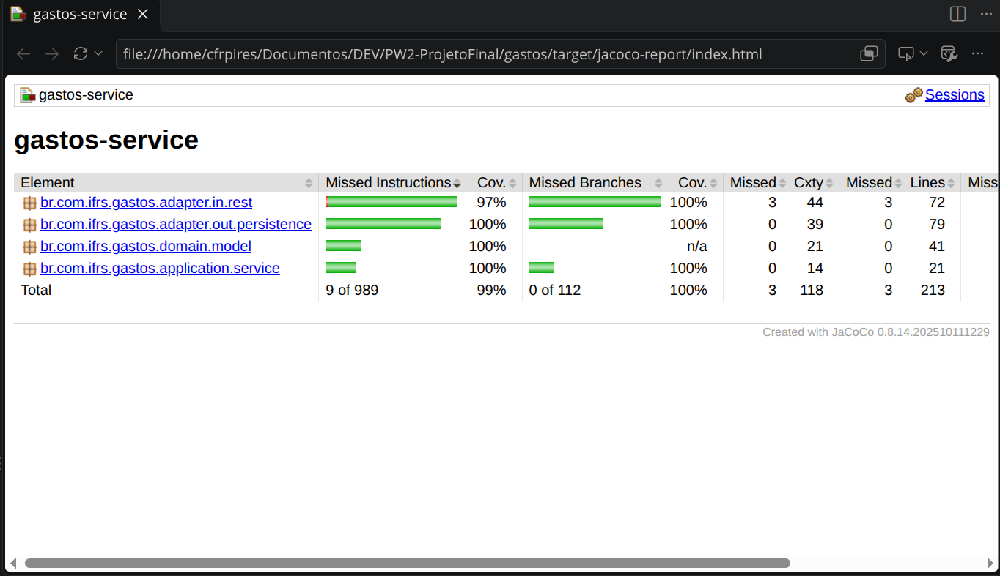
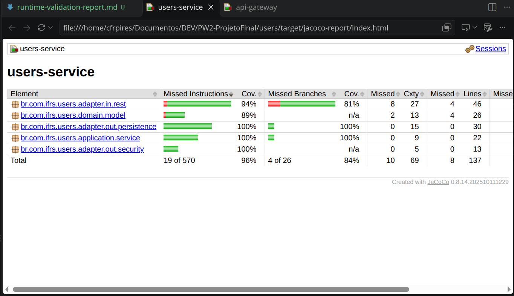
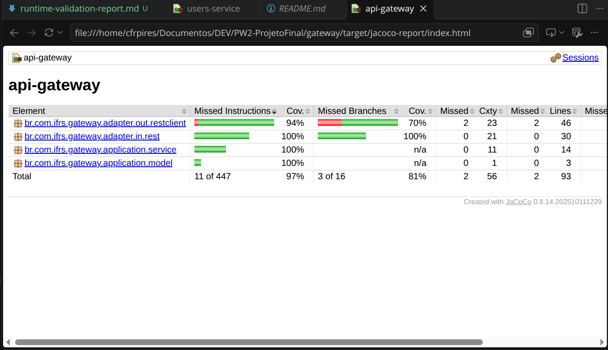
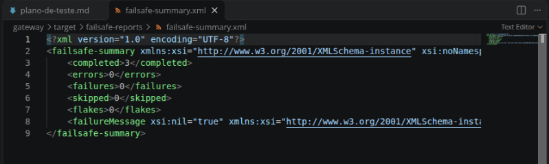

# Plano de Teste — Sistema de Gerenciamento de Gastos

**Versão:** 1.1
**Data:** 25/11/2026
**Projeto:** sistema de gerenciamento de usuários e gastos com API Gateway

## 1. Identificação do projeto

O sistema é composto por três aplicações Java independentes: o API Gateway recebe as requisições HTTP e encaminha chamadas; Users oferece cadastro, autenticação e manutenção de usuários; Gastos registra e consulta despesas e receitas. Os serviços usam JWT para autenticação e MySQL para persistência. O ambiente local é orquestrado pelo Docker Compose.

- **Linguagem:** Java 25 (LTS), padronizado nos três serviços.
- **Framework principal:** Quarkus 3.29.4.
- **Persistência:** Hibernate Reactive com Panache e cliente reativo MySQL.
- **Testes:** JUnit 5, Mockito, Quarkus Test, REST Assured e Playwright Java.
- **Análise estática:** PMD.
- **Cobertura:** JaCoCo.
- **Teste de sistema:** Playwright Java `APIRequestContext` exercitando a API completa pelo Gateway.

## 2. Escopo

### Dentro do escopo

- Resposta de saúde do Gateway e disponibilidade das rotas HTTP.
- Modelo de dados de usuário e despesa: construção, acesso a atributos e tipos de operação.
- Respostas HTTP de autenticação e autorização, incluindo acesso sem token.
- Cadastro de usuário, login, emissão e uso de JWT.
- Criação e consulta de despesas autenticadas, persistência e isolamento por usuário.
- Atualização e exclusão de despesas, incluindo confirmação da persistência e remoção.
- Configuração reproduzível de análise estática e cobertura por módulo.

### Fora do escopo

- Testes de carga, desempenho e capacidade.
- Testes de interface gráfica: o produto disponibiliza APIs REST e não possui interface web.
- Alta disponibilidade, recuperação de desastre e operação em ambiente de produção.
- Serviços externos de observabilidade (Jaeger e Graylog), exceto sua configuração de execução local.
- Auditoria abrangente de segurança ou certificação de conformidade.

## 3. Estratégia de teste

| Nível | Abordagem | Evidência |
|---|---|---|
| Estático | PMD analisa fontes de produção e teste no `verify` de cada projeto, sem bloquear por violações preexistentes. | `target/reports/pmd.html` e `target/pmd.xml` em cada módulo. |
| Unitário | JUnit 5 testa modelos e serviços de aplicação; Mockito simula portas externas para que cada serviço seja executado sozinho, sem banco, HTTP ou dependência dos outros projetos. | `src/test/java` de cada módulo e relatório JaCoCo. |
| Componente | `@QuarkusTest` com REST Assured inicia cada serviço isoladamente; valida rotas, autorização, respostas e o fluxo de criação/autenticação de usuário no Users. Quarkus Dev Services fornece MySQL descartável nos testes que precisam persistência. | Testes de componente no `src/test/java` do módulo; execução incluída no `./mvnw verify` daquele módulo. |
| Sistema | Playwright Java `APIRequestContext` envia requisições HTTP pela API Gateway contra Gateway, Users, Gastos e MySQL reais da stack Docker. | Testes `*SystemIT` e relatórios Failsafe/Surefire em `gateway/target`. |

### Jornadas críticas

1. Consultar o health check do Gateway e receber HTTP 200 com estado `UP`.
2. Fazer chamada à operação protegida de gastos sem token e receber HTTP 401 ou 403.
3. Criar usuário, autenticar e receber um JWT válido.
4. Criar uma despesa autenticada e confirmar, por leitura posterior, que foi persistida para o usuário.
5. Atualizar e excluir uma despesa, confirmar os dados alterados e verificar sua ausência após exclusão.
6. Remover usuário e dados de teste ao final, inclusive quando um cenário falhar.

## 4. Critérios de entrada e saída

### Entrada

- Código e dependências disponíveis nos três módulos Maven.
- JDK 25 e Maven instalados.
- Para testes unitários: `./mvnw` funcional no módulo em teste; nenhuma aplicação ou banco externo é necessário.
- Para testes de componente: Docker funcional para MySQL Dev Services; cada projeto é executado isoladamente e a porta HTTP de teste é escolhida dinamicamente para não colidir com serviços ativos.
- Para testes de sistema: Docker e Docker Compose funcionais; stack completa iniciada e saudável; dependências Java disponíveis. O Playwright API usa o runtime Java, sem Node.js ou instalação de navegador.
- Dados de teste identificados por e-mail único, para evitar colisão com usuários existentes.

### Saída

- Cada `./mvnw verify` executado na pasta do próprio serviço termina com código zero, incluindo testes unitários, de componente e PMD.
- O perfil separado de sistema termina com código zero, exercita fluxos de autenticação, CRUD e persistência e remove os dados únicos criados.
- PMD produz relatório para cada módulo; suas violações são revisadas e documentadas. O baseline não bloqueia builds por violações.
- JaCoCo produz relatório HTML/XML de cobertura incluindo testes JUnit e `@QuarkusTest`. A meta de referência é pelo menos 75% de cobertura de linhas nas classes de domínio e aplicação; cobertura mede execução, e não substitui asserts comportamentais.
- Falhas, limitações de ambiente e resultados não executados são explicitamente registrados; não se declara aprovação para etapas que não foram executadas.

## 5. Ambiente e ferramentas

- Java/JDK 25; Maven Wrapper configurado nos três módulos.
- Quarkus 3.29.4, JUnit 5, Mockito 5.23.0, REST Assured e Playwright Java 1.60.0 fornecidos pelas dependências Maven.
- PMD Maven Plugin 3.28.0 (PMD 7.17.0, compatível com classes Java 25) e JaCoCo Maven Plugin 0.8.13 com a extensão `quarkus-jacoco`.
- Docker Engine e Docker Compose para MySQL e execução integrada da stack.
- Playwright Java `APIRequestContext` para teste de sistema API-only; não há dependência de Node.js/browser.
- Sistema operacional Linux; Docker deve estar funcional para executar Dev Services e a stack de sistema.

## 6. Execução

Cada aplicação é um projeto Maven independente. Para executar análise estática,
testes unitários e de componente, e cobertura somente de um módulo, execute o wrapper
na raiz daquele projeto. Não execute um módulo como dependência do outro:

```bash
cd gateway
./mvnw verify
```

```bash
cd users
./mvnw verify
```

```bash
cd gastos
./mvnw verify
```

O teste de sistema é uma etapa explícita e separada: o `verify` independente normal
não depende dos outros serviços. Com Docker disponível, inicie a stack completa:

```bash
./start-services.sh -d
```

Depois que Gateway, Users, Gastos e MySQL estiverem saudáveis, execute os testes
Playwright pela raiz do Gateway:

```bash
cd gateway
./mvnw verify -Psystem-tests
```

O perfil ativa somente as classes `*SystemIT`, que chamam a API via
`APIRequestContext`. A URL padrão é `http://localhost:8080`; para outro endereço,
configure `SYSTEM_TEST_BASE_URL`. Os testes geram email com UUID e removem as
despesas e o usuário criados.

PMD grava `target/reports/pmd.html` e `target/pmd.xml`. JaCoCo grava o relatório
em `target/site/jacoco/index.html` e os dados em `target/jacoco-quarkus.exec`
em cada módulo. Para encerrar a stack Compose quando não estiver mais em uso:

```bash
docker compose down
```

O teste de sistema não inicia nem encerra a stack automaticamente, evitando
interferir em serviços que já estejam sendo usados.

## 7. Riscos e mitigação

| Risco | Impacto | Mitigação |
|---|---|---|
| Docker indisponível ou serviço não saudável | Dev Services ou teste de sistema não executável. | Verificar `docker info` e health checks; registrar como não executado, sem substituir testes de sistema por mocks. |
| Código dos serviços e contratos HTTP divergentes | Falha de integração ou dados inesperados. | Testar pelo Gateway e usar os parâmetros/headers realmente expostos pelos recursos REST. |
| Colisão com dados persistidos | Resultados instáveis ou exclusão de dados alheios. | Gerar email e tags com UUID; limpar apenas despesas e usuário criados no cenário. |
| PMD ou JaCoCo incompatível com Java 25 | Build falha ou cobertura ausente. | Fixar PMD Maven Plugin 3.28.0; usar `quarkus-jacoco`, `@{argLine}` e o mesmo arquivo de execução para os testes Quarkus e unitários. |
| Segredos e chaves locais ausentes/inválidos | Aplicações ou autenticação não iniciam. | Confirmar arquivos de configuração/chaves necessários sem publicar valores secretos nos relatórios. |
| Flutuação de tempo de inicialização de Quarkus e MySQL | Falsas falhas de disponibilidade. | Usar health checks e tentativas limitadas com intervalo e timeout no script de sistema. |

## 8. Cronograma proposto

| Atividade | Duração estimada | Resultado |
|---|---:|---|
| Preparar ambiente e verificar cada módulo | 0,5 dia | JDK, Maven e execução Maven independente conferidos. |
| Configurar PMD e JaCoCo; avaliar baseline | 0,5 dia | Relatórios estático e cobertura reproduzíveis por módulo. |
| Implementar testes unitários e de componente | 1 dia | Testes Mockito, JUnit e REST Assured por serviço. |
| Implementar e executar jornadas de sistema | 1 dia | Testes Playwright pela API Gateway com stack real. |
| Consolidar evidências e revisar rubrica | 0,5 dia | Relatórios, cobertura e limitações registrados. |

## 9. Evidências a entregar

- Este plano em `docs/plano-de-teste.md`.
- Definição do projeto em PDF: `docs/definicao-do-projeto.pdf`.
- Configuração PMD em `config/pmd-ruleset.xml` e integração Maven nos três módulos.
- Testes JUnit/Mockito/REST Assured em `src/test/java` dentro dos três projetos.
- Testes Playwright Java `*SystemIT` no Gateway, executáveis com `./mvnw verify -Psystem-tests`.
- Relatórios PMD, JaCoCo e Failsafe reproduzíveis; arquivos gerados em `target/` não precisam ser versionados.

## 10. Observação sobre arquitetura

Os três serviços usam o namespace `br.com.ifrs` e separam adaptadores de entrada,
casos de uso/portas, domínio e adaptadores de saída. Os serviços Users e Gastos
mantêm os modelos de domínio independentes das entidades Panache; o Gateway
trata REST como adaptador de entrada e saída.

# Evidencias
Subi o projeto para o git sem a pasta de target de cada projeto para não poluir o diretório. Mas vou deixar anexado as comprovações, caso queira replicar só rodar os testes na maquina do avalidor.


## Cobertura de código JACOCO
### Gastos


### Users


### Gateway


## Teste de sistema
### Playwright


# USO de LLM's
Foi utilizado ferramentas de LLM's nas seguintes atividades:
- Ajuste do projeto para arquitetura exagonal
- Instalação e importação das dependencias das ferramentas de testes nos POM's de cada projeto e criação de testes exemplos.
  - prompt utilizado:  
```marketdown

# P - persona
- Você deve atuar como um QA sênior, focado em testes automatizados de java usando o framework quarkus, e mvn.

# O - Objetivo
- Criar um plano te testes, para testes automatizados do sistema.
- Criar os testes 
	- Unitários
	- De componentes
	- E de sistemas
# A - Atributos
- A entrega final deve conter, no mínimo, os seguintes artefatos
- O que fazer
	- Leve em conta o Plano de teste criado para criar as classes ou testes necessários.
	- Levar em conta o formato proposto
	- Realizar o check list
	- Se atenha a testar individualmente cada um dos projetos quando for realizar os testes unitários
	- Quando houver alguma dependência que impeça um teste, realize a criação de um mock, utilizando o mockito.
	- Sempre que for implementar uma nova ferramenta ao projeto quarkus/mvn, busque na pagina https://vvs.rpmhub.dev/desenvolvimento/teste.html como realizar a importação para o POM
- O que não fazer
	- Não realize a criação de testes sem uma necessidade real ou desnecessário, sempre em foco dos Critérios necessários a serem atendidos.
	- Não realizar o teste unitários levando em conta outros projetos do sistema
### 1. Plano de Teste
Um arquivo em formato **Markdown** (`plano-de-teste.md`), na raiz do repositório ou em uma pasta `docs/`, contendo pelo menos:

- Escopo do teste (o que será e o que não será testado);
- Estratégia de teste (unitário, componente, sistema, estático, e demais técnicas empregadas);
- Critérios de entrada e saída (quando os testes começam e quando são considerados concluídos);
- Riscos e mitigação;
- Cronograma das atividades;
- Ambiente e ferramentas utilizadas (linguagem, framework de teste, ferramenta de análise estática, etc.).
### 2. Análise Estática
Configuração e execução de, pelo menos, **uma ferramenta de análise estática** (por exemplo, [PMD](https://vvs.rpmhub.dev/pmd/pmd.html)s, [Checkstyle](https://vvs.rpmhub.dev/estatica/estatica.html) ou [SonarQube](https://vvs.rpmhub.dev/sonar/sonar.html)), integrada ao processo de build do projeto (Maven, Gradle, npm, etc.). O relatório gerado pela ferramenta deve ser disponibilizado no repositório ou seu resultado deve ser reproduzível por quem for avaliar o trabalho.
### 3. Teste Unitário
Implementação de testes unitários que cubram as principais classes ou funções do domínio do sistema, utilizando um framework apropriado (por exemplo, [JUnit 5](https://vvs.rpmhub.dev/unitario/junit.html) com [Mockito](https://vvs.rpmhub.dev/unitario/mock.html), no caso de projetos Java). Recomenda-se o uso de uma ferramenta de cobertura de código, como o [JaCoCo](https://vvs.rpmhub.dev/jacoco/jacoco.html), para demonstrar a cobertura alcançada.
### 4. Teste de Componente
Implementação de testes que validem componentes do sistema de forma isolada, mas em um nível de granularidade maior que o teste unitário, por exemplo testes de API REST com [RestAssured](https://vvs.rpmhub.dev/componente/restassured.html), testes de repositório ou banco de dados, ou testes de módulos que integrem múltiplas classes.
### 5. Teste de Sistema
Escrita de testes de sistema que validem o comportamento do software como um todo, do ponto de vista do usuário final, utilizando ferramentas como [Selenium](https://vvs.rpmhub.dev/selenium/selenium.html), [Cypress](https://vvs.rpmhub.dev/cypress/cypress.html) ou [Playwright](https://vvs.rpmhub.dev/playwirght/playwright.html), conforme a natureza do projeto (web, API, desktop, etc.).

# F - Format
Deve ser gerado os arquivos de testes na pasta de tests de cada projeto, seguindo o modelo de testes do mvn.

Realizar a criação de testes unitários para as classes e suas funcionalidades.

## Critérios necessários:

Importar todas as dependências necessárias no POM de cada projeto e criar um teste funcional para saber se está adequado corretamente as importações.


# Checklist
[] Plano de Teste em um formato de .md
[] Implementar funcionalidades de Análise Estática, baseado no plano de testes
[] Criar os Teste Unitário para as classes para marcar que está funcionando a importação das ferramentas
	- Rodar o comando de `./mvnw verify` cada vez que realizar a implementação de um testes unitários e ver se passou, caso não passe avise
[] Realizar a criação de Teste de Componente
[] Realizar a criação de Teste de Sistema utilizando playwright

Obs: quaisquer duvidas de como utilizar as ferramentas exigidas, use os links que estão ao longo do texto que direcionam até a pagina https://vvs.rpmhub.dev/playwirght/playwright.htm com exemplos e a maneira que eu quero que sejá utilizada.

Faça um resumo de o que foi alterado, adicionado ou removido.


```
- Criação de testes para maior cobertura